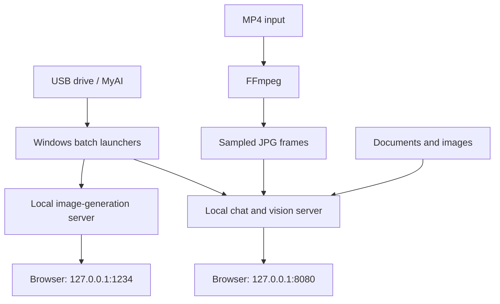

# System Architecture

## High-level flow

## Components

- **Launcher scripts:** Start local processes using paths relative to the script folder.
- **Chat/vision server:** Loads a language model and, where supported, its vision projector.
- **Image-generation server:** Loads a compatible image-generation model and serves a local interface.
- **FFmpeg helper:** Samples frames from an MP4 file for later image analysis.
- **Browser interfaces:** Connect to local services through loopback addresses.

## Network boundaries

The intended local services bind to loopback addresses. Optional web search is a separate online integration and should be documented independently. Verify actual bind addresses and network behavior for the exact application build.
