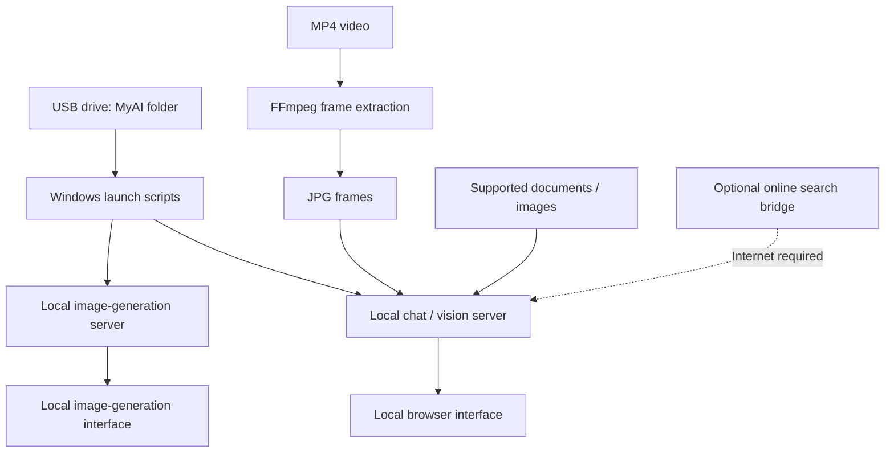

# Portable All-in-One Offline AI Pendrive Suite

[](#requirements)
[](#privacy-and-network-use)
[](#project-status)
[](LICENSE)

A portable Windows AI workstation designed to keep local AI applications, model files, and launch scripts together on a USB drive.

The planned suite combines local text and vision inference, document workflows, video-frame extraction, and local image generation. Optional online search is a separate feature and requires an internet connection and a compatible search integration.

> **Project status:** This repository documents an experimental setup. Hardware compatibility, model support, file uploads, GPU acceleration, and true zero-install behavior must be tested on each target Windows computer before being described as guaranteed.

## Contents

- [Features](#features)
- [Architecture](#architecture)
- [Requirements](#requirements)
- [USB drive layout](#usb-drive-layout)
- [Setup overview](#setup-overview)
- [Launch and usage](#launch-and-usage)
- [Privacy and network use](#privacy-and-network-use)
- [Performance notes](#performance-notes)
- [Troubleshooting](#troubleshooting)
- [Roadmap](#roadmap)
- [Contributing](#contributing)
- [License and third-party components](#license-and-third-party-components)

## Features

| Capability | Intended implementation | Notes |
|---|---|---|
| Local chat and coding help | Llamafile + a compatible GGUF model | Runs on the host computer |
| Image understanding | Vision-language model + matching projector | Requires a compatible multimodal build and interface |
| Document Q&A | Local chat interface and document-processing support | Actual PDF/CSV/code support depends on the interface |
| Video review | FFmpeg frame extraction + vision model | Frame-based analysis, not continuous video understanding |
| Local image generation | Stable Diffusion.cpp + compatible checkpoint | CPU/GPU support depends on the build and drivers |
| Optional web search | External search integration | Requires internet; not an offline feature |

## Architecture



## Requirements

### Host computer

| Component | Minimum target | Recommended target |
|---|---|---|
| Operating system | Windows 10/11, 64-bit | Updated Windows 11, 64-bit |
| RAM | 8 GB | 16 GB or more |
| Processor | Modern 64-bit Intel/AMD CPU | Recent multi-core CPU |
| GPU | Optional | Compatible GPU and supported backend |
| USB connection | USB 3.0 | USB 3.1 / USB-C |

These are planning targets, not guaranteed compatibility specifications. Running multiple models at once can require substantially more memory.

### USB drive

- 16 GB minimum is a starting point; 32 GB or larger is recommended.
- Use exFAT or NTFS. FAT32 cannot store a single file larger than 4 GB.
- A fast USB 3.x drive is recommended because model loading can be storage-intensive.
- Keep enough free space for model weights, application files, and temporary video frames.

## USB drive layout

The launcher scripts supplied in this repository currently expect the executables and model files to be alongside the scripts in the same `MyAI` folder. Keep that layout unless you also update the paths inside the scripts.

```text
MyAI/
├── START_ALL.bat
├── START_CHAT_ONLY.bat
├── start-server.bat
├── start-server.sh
├── video_to_frames.bat
├── llamafile-0.10.6.exe                 # download separately
├── Qwen2.5-VL-3B-Instruct-Q4_K_M.gguf  # download separately
├── mmproj-Qwen2.5-VL-3B-Instruct-f16.gguf # download separately
├── sd-server.exe                        # download separately
├── required runtime DLL files            # download separately
├── v1-5-pruned-emaonly-fp16.safetensors  # download separately
├── ffmpeg.exe                            # download separately
└── video_frames/                         # generated at runtime
```

Model and executable filenames may change between releases. Confirm that the actual filenames match the names referenced by your batch files.

## Setup overview

1. Format the USB drive as exFAT or NTFS if needed.
2. Create a folder named `MyAI` on the USB drive.
3. Download the required applications from their official project release pages.
4. Download model files from their official model repositories and review their licenses.
5. Put the binaries, dependencies, and model files in the expected folder.
6. Review each `.bat` file before running it.
7. Test each service separately before using the combined launcher.

See [Installation](docs/INSTALLATION.md) for the detailed checklist and source links.

## Launch and usage

### Start both local services

Double-click `START_ALL.bat`. Keep the terminal windows open while using the services.

- Chat / vision interface: `http://127.0.0.1:8080`
- Image-generation interface: `http://127.0.0.1:1234`

These addresses are loopback addresses and are intended to be accessed from the same computer.

### Start chat only

Use `START_CHAT_ONLY.bat` when you do not need image generation. This may reduce memory pressure, but actual memory use depends on the model, context length, and backend.

### Extract video frames

Drag an MP4 file onto `video_to_frames.bat`. The script is intended to extract one JPEG frame every five seconds into `video_frames`. Review the generated frames before uploading them to the vision interface.

More details: [Usage guide](docs/USAGE.md).

## Privacy and network use

- Local model inference is intended to run on the host computer.
- Localhost web interfaces are not the same as public cloud services.
- Optional web search requires internet access and may send search queries to the selected search provider.
- Do not assume every frontend feature is offline or private; check its configuration and network behavior.
- Do not expose the local server ports to a public network unless you understand and secure that setup.
- Avoid placing personal documents or confidential files in public repositories or issue reports.

## Performance notes

- GPU acceleration is backend-, driver-, and hardware-dependent. A flag such as `-ngl 99` does not guarantee acceleration on every NVIDIA, AMD, or Intel system.
- CPU-only operation may be slower.
- Running chat and image generation simultaneously can exceed available RAM.
- Smaller or more heavily quantized models can reduce memory use, often with a quality trade-off.
- USB speed affects model loading and file operations.

## Troubleshooting

| Symptom | Checks |
|---|---|
| `.gguf` file opens in another app | Check the command line and model path in the launcher; verify the executable is being called |
| Missing DLL error | Confirm all DLL dependencies from the same release archive are present; check required runtime libraries |
| Port already in use | Check whether another process is using port 8080 or 1234 |
| Server exits immediately | Run the command in a terminal and read the full error message |
| Model not found | Compare the exact filename and folder location with the launcher command |
| Slow generation | Try CPU/GPU backend settings supported by the specific build; reduce model/context size |
| Video frames are missing | Confirm FFmpeg runs and the input file is a supported MP4 |

See [Troubleshooting](docs/TROUBLESHOOTING.md).

## Roadmap

- [ ] Verify and document exact tested release versions and checksums
- [ ] Test on a clean Windows 10 computer
- [ ] Test on a clean Windows 11 computer
- [ ] Validate CPU-only startup
- [ ] Validate supported GPU backends
- [ ] Confirm PDF, CSV, image, and code upload workflows
- [ ] Add screenshots of the actual running interfaces
- [ ] Add startup checks for missing files and occupied ports
- [ ] Add a clean shutdown script
- [ ] Document optional online search configuration

## Contributing

Bug reports, documentation improvements, and tested compatibility notes are welcome. Please include Windows version, hardware details, application release versions, and the exact error message. Do not include private documents, access tokens, or personal data.

## License and third-party components

The original scripts and documentation in this repository are intended to be released under the MIT License; see [LICENSE](LICENSE).

Llamafile, model weights, Stable Diffusion.cpp, FFmpeg, and other third-party components retain their own licenses and terms. The MIT license for this repository does not grant rights to third-party software or model weights. Review each component's license before downloading or redistributing it.
