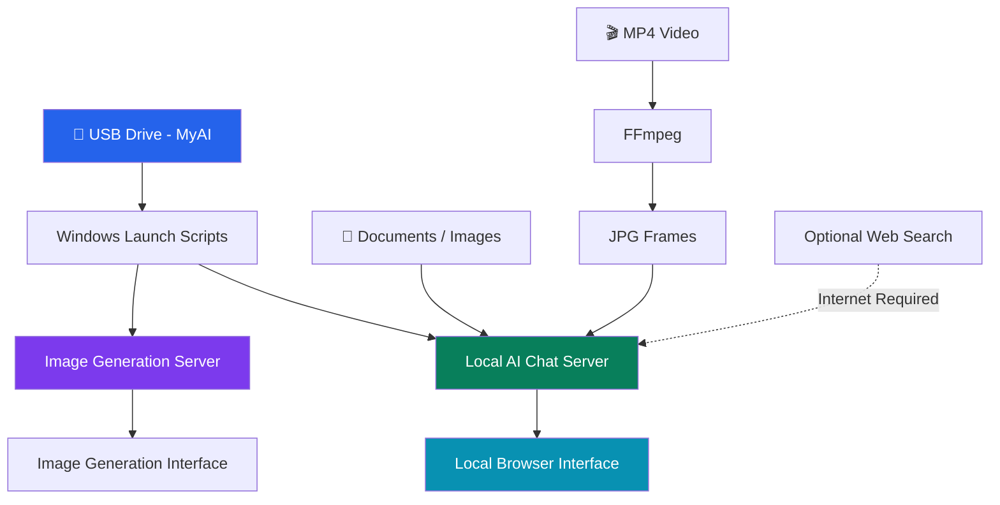

# 🚀 Portable All-in-One Offline AI Pendrive Suite

<div align="center">

<!-- Replace with your uploaded GitHub banner -->


### 🧠 Your Personal AI Workstation — Anywhere, Anytime!

**Plug in. Launch. Create. No cloud dependency for local inference.**


[✨ Features](#-features) • [⚙️ Installation](#️-installation) • [🏗️ Architecture](#️-system-architecture) • [📁 Structure](#-project-structure) • [🛡️ Privacy](#-privacy--security)

</div>

---

## 🌟 1. Project Overview

**Portable All-in-One Offline AI Pendrive Suite** is an experimental portable Windows AI workstation that brings multiple local AI capabilities together inside one USB drive.

The goal is simple:

> Carry your own AI workstation in your pocket. Plug it into a compatible Windows computer and run local AI tools without depending on cloud AI services.

The suite combines local language models, vision-language models, document workflows, video-frame extraction and local image generation.

https://github.com/user-attachments/assets/ef41c407-3d63-4ded-b5f6-aab5da2553f2
### 🎯 Project vision

- 🧠 Local AI chat and coding assistance.
- 👁️ Image understanding and visual analysis.
- 📄 Document analysis and question answering.
- 🎬 Video frame extraction and AI review.
- 🎨 Local AI image generation.
- 🔒 Local-first data processing.
- 🌐 Optional online search when internet access is available.

**Important:** This is an experimental portable setup, not a guaranteed zero-install solution. Hardware, drivers, dependencies and application compatibility must be tested on each computer.

---

## ✨ 2. Features

| Feature | Technology | Purpose |
|---|---|---|
| 🧠 AI Chat | Llamafile + GGUF | Local conversations |
| 💻 Coding Assistant | Compatible language model | Programming help |
| 👁️ Vision AI | Qwen2.5-VL | Image understanding |
| 📚 Document AI | Local interface | Document Q&A |
| 🎬 Video Analysis | FFmpeg + Vision AI | Frame-based video review |
| 🎨 Image Generation | Stable Diffusion.cpp | Generate images locally |
| 🌐 Web Search | Optional integration | Online information retrieval |
| 🔐 Privacy | Local inference | Keep processing on host computer |

### 🧠 Local AI Chat

Run compatible GGUF language models through Llamafile.

Possible applications:
- General conversations.
- Programming assistance.
- Text generation.
- Explanations and learning.
- Brainstorming.

### 👁️ Vision Intelligence

Use a compatible vision-language model with its matching projector file.

Planned model:
- Qwen2.5-VL-3B-Instruct.
- Compatible GGUF model.
- Matching multimodal projector.

Capabilities depend on the selected model and frontend.

### 📄 Document Intelligence

The planned document workflow aims to support:

- PDF analysis.
- CSV data review.
- Text documents.
- Code explanation.
- Image-based questions.

Actual upload and parsing support depends on the selected interface and its integrations.

### 🎬 AI Video Review

Convert video into individual frames using FFmpeg.

**Workflow:**

MP4 Video → FFmpeg → JPG Frames → Vision AI → Analysis

The system performs frame-based analysis, not continuous real-time video understanding.

### 🎨 Local Image Generation

Use Stable Diffusion.cpp with a compatible checkpoint to generate images locally.

Planned checkpoint:

`v1-5-pruned-emaonly-fp16.safetensors`

GPU acceleration depends on the installed backend, drivers and hardware.

### 🌐 Optional Web Search

Online search is an optional feature.

- Requires internet connectivity.
- Requires a compatible search integration.
- May transmit search queries to an external provider.
- Is not part of offline inference.

---

## 🏗️ 3. System Architecture

The following diagram illustrates the planned system.



### 🔄 How it works

1. Connect the USB drive.
2. Open the `MyAI` folder.
3. Execute the appropriate Windows launcher.
4. Start the local AI services.
5. Open the local browser interface.
6. Select the required AI capability.
7. Process supported files locally.

---

## 📁 4. Project Structure

The proposed repository organization:

```text
Portable-Offline-AI/
│
├── README.md
├── LICENSE
├── .gitignore
│
├── assets/
│   ├── github-banner.png
│   ├── ai-suite-banner.gif
│   ├── architecture.png
│   ├── screenshots/
│   └── demos/
│
├── MyAI/
│   ├── START_ALL.bat
│   ├── START_CHAT_ONLY.bat
│   ├── start-server.bat
│   ├── start-server.sh
│   │
│   ├── video_to_frames.bat
│   │
│   ├── llamafile-0.10.6.exe
│   │
│   ├── Qwen2.5-VL-3B-Instruct-Q4_K_M.gguf
│   ├── mmproj-Qwen2.5-VL-3B-Instruct-f16.gguf
│   │
│   ├── sd-server.exe
│   ├── v1-5-pruned-emaonly-fp16.safetensors
│   │
│   ├── ffmpeg.exe
│   ├── runtime/
│   └── video_frames/
│
├── docs/
│   ├── INSTALLATION.md
│   ├── USAGE.md
│   └── TROUBLESHOOTING.md
│
└── examples/
    ├── sample-prompts.md
    └── video-workflow.md
```

**Note:** This is an organized target structure. Some folders are proposed additions. Large model files and third-party binaries should generally be downloaded separately rather than committed to Git.

---

## 💻 5. System Requirements

| Component | Minimum target | Recommended target |
|---|---|---|
| OS | Windows 10/11 64-bit | Updated Windows 11 |
| RAM | 8 GB | 16 GB or more |
| CPU | Modern 64-bit Intel/AMD | Recent multi-core CPU |
| GPU | Optional | Compatible GPU |
| USB | USB 3.0 | USB 3.1 / USB-C |
| Storage | 16 GB starting point | 32 GB or more |

Actual storage requirements depend on model sizes and the number of applications installed.

---

## ⚙️ 6. Installation

### Step 1 — Prepare your USB drive

1. Connect your USB drive.
2. Format it using exFAT or NTFS.
3. Create a folder named `MyAI`.
4. Keep enough free space for models and temporary files.

### Step 2 — Download applications

Download the required software from its official project release page.

- Llamafile.
- FFmpeg.
- Stable Diffusion.cpp.
- Required runtime dependencies.

### Step 3 — Download AI models

Download compatible model files and check their licenses.

- Qwen2.5-VL GGUF.
- Matching vision projector.
- Stable Diffusion checkpoint.

### Step 4 — Organize files

Place the downloaded applications and models in the expected locations.

Check every filename against the launcher scripts.

### Step 5 — Review launch scripts

Before execution, inspect the `.bat` files and verify:

- Executable paths.
- Model paths.
- Required DLL files.
- Port availability.
- Backend configuration.

### Step 6 — Start the AI suite

Run:

`START_ALL.bat`

Keep the terminal windows open while the services are running.

---

## 🚀 7. Launch and Usage

### Start all services

```bat
START_ALL.bat
```

### Start chat only

```bat
START_CHAT_ONLY.bat
```

### Local interfaces

| Service | Address |
|---|---|
| 🧠 Chat / Vision | http://127.0.0.1:8080 |
| 🎨 Image Generation | http://127.0.0.1:1234 |

These are intended for access from the same computer.

### 🎬 Video-to-Frames Workflow

Drag an MP4 file onto:

`video_to_frames.bat`

The intended extraction interval is one frame every five seconds.

Generated frames are stored in:

`video_frames/`

Review the extracted frames before submitting them to the vision interface.

---

## 🔐 8. Privacy & Security

Privacy is one of the main design goals.

- Local model inference is intended to run on the host computer.
- Localhost interfaces are intended for local access.
- Offline inference does not require cloud AI access.
- Optional web search requires internet connectivity.
- External integrations may transmit queries or data.
- Do not expose local server ports publicly without appropriate security.
- Do not assume every frontend feature works offline.

**Privacy warning:** Verify application network behavior and configuration before using confidential documents.

---

## ⚡ 9. Performance Optimization

For better performance:

- Use a fast USB 3.x drive.
- Prefer smaller or quantized models when memory is limited.
- Close unnecessary applications.
- Avoid running multiple large models simultaneously.
- Use supported GPU backends where available.
- Reduce context size if memory is insufficient.

A GPU command-line flag alone does not guarantee hardware acceleration.

---

## 🛠️ 10. Troubleshooting

| Problem | Possible solution |
|---|---|
| Model not found | Verify exact model filename and path |
| Missing DLL | Check dependencies and runtime libraries |
| Port already in use | Check ports 8080 and 1234 |
| Server closes immediately | Run from CMD and inspect errors |
| Slow generation | Reduce model size or context |
| GPU not working | Verify backend and drivers |
| Video frames missing | Verify FFmpeg and input file |
| Out of memory | Close other applications or use a smaller model |

See `docs/TROUBLESHOOTING.md` for detailed troubleshooting.

---

## 🗺️ 11. Development Roadmap

- [ ] Complete portable Windows folder structure.
- [ ] Verify application versions and checksums.
- [ ] Test Windows 10 compatibility.
- [ ] Test Windows 11 compatibility.
- [ ] Verify CPU-only operation.
- [ ] Test supported GPU backends.
- [ ] Validate vision model and projector compatibility.
- [ ] Test PDF, CSV and image workflows.
- [ ] Improve video frame extraction.
- [ ] Add automated startup checks.
- [ ] Add clean shutdown functionality.
- [ ] Create animated demonstration GIFs.
- [ ] Add actual application screenshots.
- [ ] Document optional web search configuration.
- [ ] Verify offline operation on a clean computer.

---

## 🤝 12. Contributing

Contributions are welcome!

You can help by:

- Reporting bugs.
- Improving documentation.
- Testing Windows compatibility.
- Suggesting optimizations.
- Sharing verified configurations.
- Improving launcher scripts.

When reporting an issue, include:

- Windows version.
- CPU and RAM.
- GPU model, if applicable.
- Application versions.
- Exact error message.

Never share private documents, passwords or access tokens.

---

## 📜 13. License

The original scripts and documentation are intended to use the MIT License.

Third-party applications, model weights, checkpoints and dependencies have their own licenses and distribution terms.

Always review individual licenses before downloading or redistributing them.

See [LICENSE](LICENSE).

---

## ⭐ 14. Support the Project

If you find this project useful:

- ⭐ Star this repository.
- 🍴 Fork the project.
- 🐛 Report bugs.
- 💡 Suggest new features.
- 🤝 Contribute improvements.

Every contribution helps make portable local AI more accessible!

<div align="center">

### 🚀 Your AI. Your USB. Your Control.

**Built for experimentation, portability and privacy.**

🧠 Think • 💻 Create • 🎨 Generate • 🔒 Stay Local

</div>
